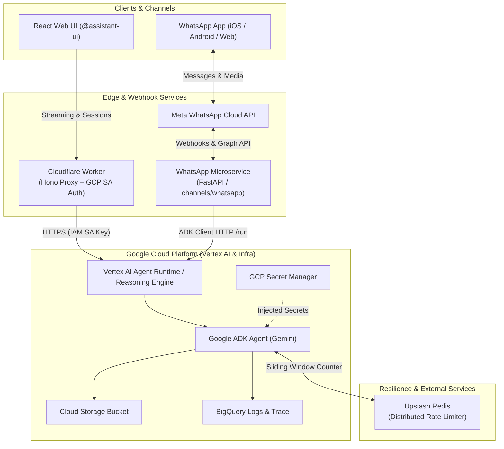

# 🤖 Fullstack ADK Chat Assistant Template

A production-ready fullstack template for developing, testing, and deploying multimodal conversational agents powered by **Google ADK (Agent Development Kit)** and **Gemini**.

Equipped with a modern web interface built with **React + @assistant-ui** deployable to **Cloudflare Workers**, a **WhatsApp Cloud API** integration channel, automated rate limiting via **Upstash Redis**, and Infrastructure as Code with **Terraform** on **Google Cloud Platform (GCP)**.

🔗 **Live Demo:** [https://chat-assistant-web.janf-agentic-architect.workers.dev/](https://chat-assistant-web.janf-agentic-architect.workers.dev/)

---

## ✨ Key Features

- **🧠 Google ADK & Gemini 2.5 / 3.5**: Full conversational lifecycle, tools execution, and native session management.
- **🎨 Multimodal Processing**: Ingest and understand text, images, voice notes, and audio attachments across both Web and WhatsApp channels.
- **🌐 Cloudflare Workers Web UI**: Fast edge-rendered interface powered by Hono and `@assistant-ui` with real-time streaming and custom media renderers.
- **📱 WhatsApp Cloud API Channel**: Dedicated FastAPI microservice handling webhooks, Meta media downloads, Base64 formatting for ADK, and persistent per-phone sessions.
- **🛡️ Distributed Rate Limiting**: Built-in `UpstashRateLimitPlugin` for ADK protecting agent endpoints from abuse.
- **🔐 Secret Synchronization**: Automated synchronization between local environment variables and **GCP Secret Manager** with seamless injection during deployment.
- **☁️ Vertex AI Agent Runtime**: Infrastructure as Code with Terraform to provision Vertex AI Reasoning Engine, Cloud Storage, and BigQuery logging sinks.

---

## 🏛️ Architecture Overview



---

## 📦 Project Structure

```
.
├── Makefile                     # Task automation (dev, infra, secrets, deploy, rename)
├── agents/                      # ADK Agents
│   └── chat-assistant/          # Conversational agent implementation
│       ├── app/
│       │   ├── agent.py         # Root agent definition, tools & plugins
│       │   ├── fast_api_app.py  # FastAPI server for local execution
│       │   ├── rate_limiter.py  # Upstash Redis rate limiting plugin
│       │   └── app_utils/       # Utilities and configuration
│       ├── tests/               # Unit, integration, and rate limiter tests
│       ├── pyproject.toml       # Python dependencies managed with uv
│       ├── agents-cli-manifest.yaml
│       └── .env.example         # Template for local environment & secrets
├── channels/                    # Omnichannel Messaging Services
│   ├── README.md                # Channels overview
│   └── whatsapp/                # WhatsApp Cloud API microservice
│       ├── main.py              # FastAPI entrypoint
│       ├── router.py            # Webhook verification & incoming event handler
│       ├── service.py           # Background processor & ADK dispatcher
│       ├── adk_client.py        # Client adapter for ADK API
│       ├── client.py            # Meta Graph API media & messaging client
│       └── README.md            # Detailed WhatsApp configuration guide
├── web/                         # Web Application & Edge API Proxy
│   ├── src/
│   │   ├── components/          # React components (@assistant-ui thread & attachments)
│   │   ├── gcp-auth.ts          # JWT token generation for GCP Service Account
│   │   ├── index.tsx            # Hono server & /api/adk/* proxy
│   │   └── style.css            # Styles for chat layout & media previews
│   ├── wrangler.jsonc           # Cloudflare Workers configuration
│   └── package.json             # Node.js dependencies (pnpm)
└── infra/                       # Infrastructure as Code (Terraform)
    ├── apis.tf                  # Google Cloud APIs enablement
    ├── iam.tf                   # Service Accounts, roles, and keys for Web Caller
    ├── secrets.tf               # Secret Manager resources
    ├── service.tf               # Vertex AI Reasoning Engine / Agent Runtime
    ├── storage.tf               # Storage and logging buckets
    ├── telemetry.tf             # Logging and BigQuery sinks
    ├── sync_secrets.py          # Automatic local .env to Secret Manager sync script
    └── vars/env.tfvars          # Terraform environment variables
```

---

## 🛠️ Prerequisites

Ensure you have the following tools installed and configured:

- **[Python >= 3.10](https://www.python.org/)** and **[uv](https://docs.astral.sh/uv/)** (fast Python package manager).
- **[Google Agents CLI](https://cloud.google.com/vertex-ai/docs)**:
  ```bash
  uv tool install google-agents-cli
  # Or initialize with:
  uvx google-agents-cli setup
  ```
- **[Google Cloud SDK (`gcloud`)](https://cloud.google.com/sdk/docs/install)** authenticated and configured:
  ```bash
  gcloud auth login
  gcloud auth application-default login
  gcloud config set project <YOUR_PROJECT_ID>
  ```
- **[Node.js >= 18](https://nodejs.org/)** and **[pnpm](https://pnpm.io/)**.
- **[Terraform >= 1.5](https://www.terraform.io/)**.
- **[Wrangler CLI](https://developers.cloudflare.com/workers/wrangler/)** (Cloudflare):
  ```bash
  npx wrangler login
  ```
- *(Optional - for WhatsApp)*: **[ngrok](https://ngrok.com/)** and a [Meta for Developers](https://developers.facebook.com/) account.
- *(Optional - for Rate Limiting)*: An [Upstash Redis](https://upstash.com/) database URL and token.

---

## 🚀 Quick Start (Local Development)

### 1. Run the Agent Locally

Start the interactive development environment (`agents-cli` Playground):

```bash
make dev-agent
```
> Or directly within `agents/chat-assistant`: `agents-cli playground`

### 2. Run the Web Application Locally

In a separate terminal, launch the React + Hono frontend:

```bash
make dev-web
```
Open your browser at `http://localhost:5173`. The web interface will automatically connect to your local agent at `http://localhost:8080`.

### 3. Run the WhatsApp Channel (Optional)

Configure your credentials in `channels/whatsapp/.env` (see [channels/whatsapp/README.md](channels/whatsapp/README.md)), then start the webhook service and an ngrok tunnel in a single command:

```bash
make dev-whatsapp-tunnel
```
> Or run separately: `make dev-whatsapp` (port 8001) and `make tunnel-whatsapp`.

---

## 📱 Channels & Multimodal Support

### Multimodal Chat (Web UI)
The web client features rich attachment handling:
- **Images**: Inline previews, lightboxes, and visual question answering with Gemini.
- **Audio & Voice Notes**: Visual audio player controls with real-time waveform representation and Gemini audio transcription/reasoning.

### WhatsApp Cloud API Integration
The `channels/whatsapp` microservice handles Meta webhooks asynchronously:
- Verifies Meta webhook challenges (`GET /webhook`).
- Acknowledges `POST /webhook` with `200 OK` instantly and processes payloads in background tasks.
- Downloads voice notes, audio files, images, and documents via Meta Graph API.
- Converts raw media to Base64 `inline_data` Content objects for Google ADK.
- Maps user phone numbers to persistent sessions (`wa_<phone_number>`).

For detailed webhook setup in Meta Developer Portal, see [channels/whatsapp/README.md](channels/whatsapp/README.md).

---

## 🔐 Secrets & Rate Limiting

### Automated Secret Manager Sync
Any sensitive configuration placed in `agents/chat-assistant/.env` (e.g., Upstash credentials, API tokens) can be synced to GCP Secret Manager with:

```bash
make sync-secrets
```
This utility:
1. Inspects key-value pairs in `.env`.
2. Creates or updates secrets in GCP Secret Manager.
3. Grants read access to the Agent Runtime service account.
4. Generates `.secrets_args` so `agents-cli deploy` automatically binds them into the deployed agent container.

### Upstash Redis Rate Limiting
The agent incorporates `UpstashRateLimitPlugin` implementing a sliding window algorithm:
```python
# agents/chat-assistant/app/agent.py
rate_limiter = UpstashRateLimitPlugin(
    max_requests=int(os.getenv("RATE_LIMIT_MAX_REQUESTS", "50")),
    window_seconds=int(os.getenv("RATE_LIMIT_WINDOW_SECONDS", "86400")),
)
```
If limits are exceeded, a polite fallback message is returned without consuming model tokens.

---

## ☁️ Production Deployment

The project includes an automated deployment workflow via `Makefile` to provision infrastructure on GCP, deploy the agent to Vertex AI, and publish the web app to Cloudflare Workers.

### Full Deployment (One-Command)

```bash
make deploy-all
```

This command executes the following steps sequentially:
1. **Infrastructure (`make infra`)**: Applies Terraform in `infra/`, provisions the Reasoning Engine, creates storage buckets, sets up Secret Manager, and generates Service Account credentials.
2. **Metadata Sync (`make sync-metadata`)**: Synchronizes the Agent Runtime Resource ID to `deployment_metadata.json`.
3. **Secrets Sync (`make sync-secrets`)**: Syncs all environment variables from `agents/chat-assistant/.env` into GCP Secret Manager.
4. **Agent Deployment (`make deploy-agent`)**: Packages and deploys the agent to Vertex AI Agent Runtime using `agents-cli deploy` with bound secrets.
5. **Web Deployment (`make deploy-web`)**: Builds and deploys the frontend to Cloudflare Workers, automatically injecting `AGENT_RUNTIME_API_URL` and `GCP_SA_KEY_JSON`.

### Makefile Commands Reference

| Command | Category | Description |
|---------|----------|-------------|
| `make dev-agent` | Local Dev | Run local agent playground with `agents-cli` |
| `make dev-web` | Local Dev | Start Vite + Hono frontend development server |
| `make dev-whatsapp` | Local Dev | Start WhatsApp webhook server on port 8001 |
| `make tunnel-whatsapp` | Local Dev | Open an ngrok tunnel to port 8001 |
| `make dev-whatsapp-tunnel`| Local Dev | Concurrently start WhatsApp webhook & ngrok tunnel |
| `make infra-plan` | Infra | Preview GCP infrastructure changes with Terraform |
| `make infra` | Infra | Apply GCP infrastructure and synchronize metadata |
| `make sync-metadata` | Infra | Write Agent Runtime ID from Terraform to `deployment_metadata.json` |
| `make sync-secrets` | Infra | Synchronize `agents/chat-assistant/.env` to GCP Secret Manager |
| `make deploy-agent` | Deploy | Deploy agent to Vertex AI Agent Runtime with bound secrets |
| `make deploy-status` | Deploy | Check deployment progress in Vertex AI Agent Runtime |
| `make deploy-web` | Deploy | Build & deploy web app to Cloudflare Workers with secrets |
| `make deploy-all` | Deploy | Execute full pipeline: infra -> sync -> deploy agent -> deploy web |
| `make rename` | Tooling | Rename the agent and web app across all project configs |

---

## 🔄 Renaming the Project

To customize this template for a new project, automatically update directory names, manifests, Terraform variables, and Cloudflare configurations:

```bash
make rename NAME=my-assistant WEB_NAME=my-assistant-web
```

---

## 🧪 Testing and Evaluation

### Agent Unit & Integration Tests
```bash
cd agents/chat-assistant
uv run pytest tests/unit tests/integration
```

### LLM Evaluation
Run automated quality evaluations against your dataset:
```bash
cd agents/chat-assistant
agents-cli eval
```

### WhatsApp Integration Tests
```bash
cd channels
uv run pytest tests/
```

---

## 📊 Observability and Telemetry

The agent is fully instrumented for enterprise monitoring:
- **Cloud Trace**: Distributed tracing for model invocations, tool executions, and step latency.
- **Cloud Logging & BigQuery**: Structured conversation logging, session persistence, and analytics sinks.

---

## 📄 License

This project is licensed under the Apache 2.0 License. See source file headers for details.
