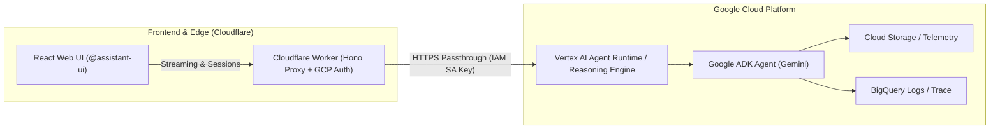

# 🤖 Fullstack ADK Chat Assistant Template

A production-ready fullstack template for developing, testing, and deploying conversational agents powered by **Google ADK (Agent Development Kit)** and **Gemini**, integrated with a modern web interface built in **React + @assistant-ui** deployable to **Cloudflare Workers**, and Infrastructure as Code with **Terraform** on **Google Cloud Platform (GCP)**.

---

## 🏛️ Architecture Overview



---

## 📦 Project Structure

```
.
├── Makefile                     # Task automation (infra, deploy, dev, rename)
├── agents/                      # ADK Agents
│   └── chat-assistant/          # Conversational agent implementation
│       ├── app/
│       │   ├── agent.py         # Root agent definition & tools
│       │   ├── fast_api_app.py  # FastAPI server for local execution
│       │   └── app_utils/       # Utilities and configuration
│       ├── tests/               # Unit and integration tests
│       ├── pyproject.toml       # Python dependencies managed with uv
│       └── agents-cli-manifest.yaml
├── web/                         # Web Application & Edge API Proxy
│   ├── src/
│   │   ├── components/          # React components (@assistant-ui)
│   │   ├── gcp-auth.ts          # JWT token generation for GCP Service Account
│   │   └── index.tsx            # Hono server & /api/adk/* proxy
│   ├── wrangler.jsonc           # Cloudflare Workers configuration
│   └── package.json             # Node.js dependencies (pnpm)
└── infra/                       # Infrastructure as Code (Terraform)
    ├── apis.tf                  # Google Cloud APIs enablement
    ├── iam.tf                   # Service Accounts, roles, and keys for Web Caller
    ├── service.tf               # Vertex AI Reasoning Engine / Agent Runtime
    ├── storage.tf               # Storage and logging buckets
    ├── telemetry.tf             # Logging and BigQuery sinks
    └── vars/env.tfvars          # Terraform environment variables
```

---

## 🛠️ Prerequisites

Ensure you have the following tools installed and configured:

- **[Python >= 3.10](https://www.python.org/)** and **[uv](https://docs.astral.sh/uv/)** (fast Python package manager).
- **[Google Agents CLI](https://cloud.google.com/vertex-ai/docs)**:
  ```bash
  uv tool install google-agents-cli
  # Or initialize with:
  uvx google-agents-cli setup
  ```
- **[Google Cloud SDK (`gcloud`)](https://cloud.google.com/sdk/docs/install)** authenticated and configured:
  ```bash
  gcloud auth login
  gcloud auth application-default login
  gcloud config set project <YOUR_PROJECT_ID>
  ```
- **[Node.js >= 18](https://nodejs.org/)** and **[pnpm](https://pnpm.io/)**.
- **[Terraform >= 1.5](https://www.terraform.io/)**.
- **[Wrangler CLI](https://developers.cloudflare.com/workers/wrangler/)** (Cloudflare):
  ```bash
  npx wrangler login
  ```

---

## 🚀 Quick Start (Local Development)

### 1. Run the Agent Locally

Interact with the agent in the interactive development environment (`agents-cli` Playground):

```bash
make dev-agent
```
> Or directly within `agents/chat-assistant`: `agents-cli playground`

### 2. Run the Web Application Locally

In a separate terminal, launch the React + Hono frontend:

```bash
make dev-web
```
Open your browser at `http://localhost:5173`. The web interface will automatically connect to your local agent at `http://localhost:8080`.

---

## ☁️ Production Deployment

The project includes an automated deployment workflow via `Makefile` to provision infrastructure on GCP, deploy the agent to Vertex AI, and publish the web app to Cloudflare Workers.

### Full Deployment (One-Command)

```bash
make deploy-all
```

This command executes the following steps sequentially:
1. **Infrastructure (`make infra`)**: Applies Terraform in `infra/`, creates storage buckets, enables required APIs, provisions the Reasoning Engine, and generates the Service Account credentials.
2. **Metadata Sync (`make sync-metadata`)**: Synchronizes the Agent Runtime Resource ID to `deployment_metadata.json`.
3. **Agent Deployment (`make deploy-agent`)**: Packages and deploys the agent to Vertex AI Agent Runtime using `agents-cli deploy`.
4. **Web Deployment (`make deploy-web`)**: Builds and deploys the frontend to Cloudflare Workers, automatically injecting the `AGENT_RUNTIME_API_URL` and `GCP_SA_KEY_JSON` secrets.

### Individual Deployment Commands

| Command | Description |
|---------|-------------|
| `make infra-plan` | Preview GCP infrastructure changes with Terraform |
| `make infra` | Apply GCP infrastructure and synchronize metadata |
| `make deploy-agent` | Deploy only the agent to Vertex AI Agent Runtime |
| `make deploy-status` | Check the status of an ongoing deployment in Agent Runtime |
| `make deploy-web` | Build, deploy the web app to Cloudflare, and update secrets |

---

## 🔄 Renaming the Project

To use this template as the foundation for a new project under a different name, you can automatically rename all components (directories, manifests, Terraform configs, and Cloudflare settings):

```bash
make rename NAME=my-assistant WEB_NAME=my-assistant-web
```

---

## 🧪 Testing and Evaluation

To test and evaluate the agent:

```bash
cd agents/chat-assistant

# Run unit and integration tests
uv run pytest tests/unit tests/integration

# Run LLM behavior evaluation
agents-cli eval
```

---

## 📊 Observability and Telemetry

The agent includes built-in telemetry instrumented for Vertex AI:
- **Cloud Trace**: Distributed tracing for model invocations, tool calls, and step execution.
- **Cloud Logging & BigQuery**: Structured conversation logging and performance metrics.

---

## 📄 License

This project is licensed under the Apache 2.0 License. See source file headers for details.
